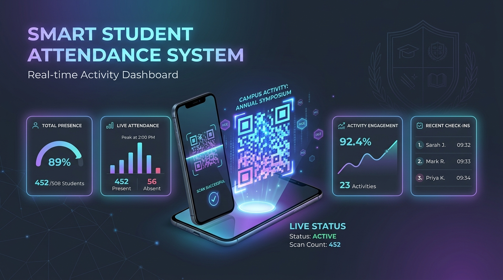
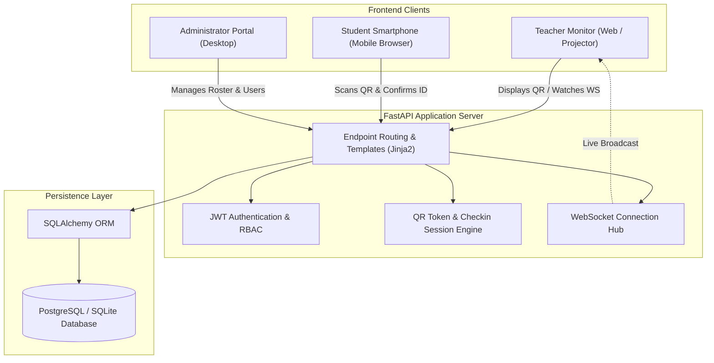
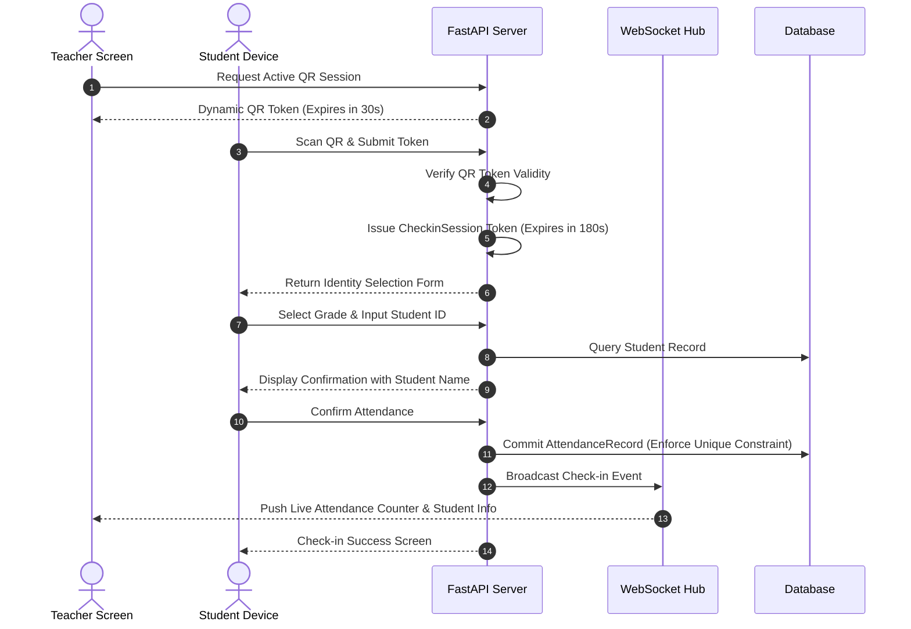
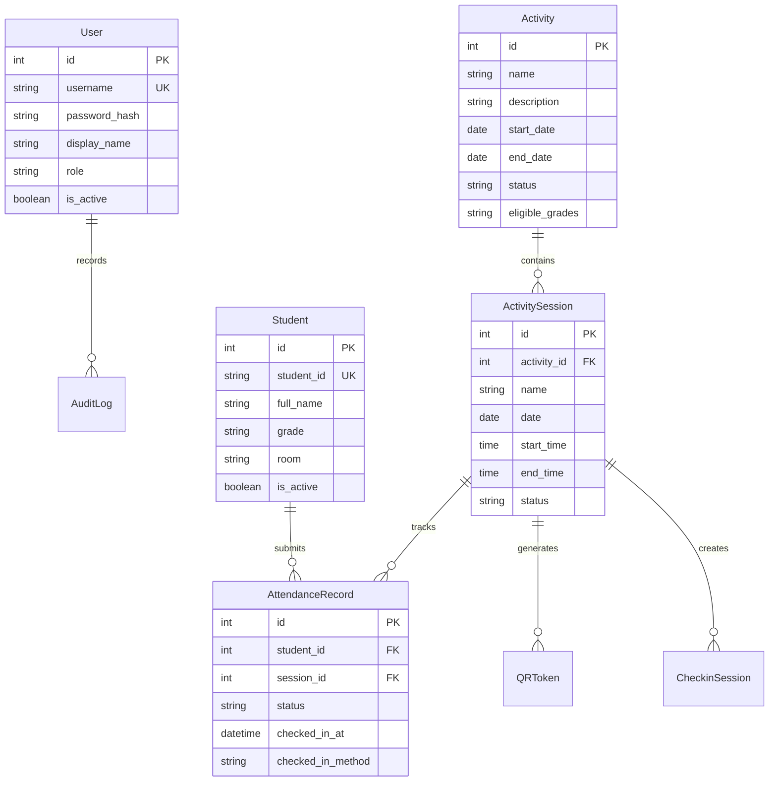

<div align="center">

  

  # Student Activity Attendance System
  ### ระบบบันทึกเวลาและการเข้าร่วมกิจกรรมนักเรียนแบบเรียลไทม์

  An enterprise-grade, real-time activity attendance platform designed for modern educational institutions. Featuring anti-cheat dynamic QR codes, instant WebSocket synchronization, automated roster import, and comprehensive multi-format reporting.

  <br/>

  [](https://www.python.org/)
  [](https://fastapi.tiangolo.com/)
  [](https://www.sqlalchemy.org/)
  [](https://websockets.readthedocs.io/)
  [](https://www.docker.com/)

</div>

<br/>

<p align="center">
  
</p>

---

## Overview

The **Student Activity Attendance System** is an end-to-end web platform built to streamline attendance management for school events, workshops, club sessions, and institutional assemblies. Traditional paper-based check-ins are prone to delays, data entry errors, and proxy check-ins. This solution replaces manual workflows with **time-expiring, dynamic QR code verification** and a **live WebSocket monitor**, allowing educators to oversee attendance in real-time while students check in effortlessly from their personal smartphones.

### Key Highlights

* **Anti-Fraud Dynamic QR Codes**: Emits short-lived QR tokens (30s validity) to prevent screenshot sharing between students.
* **Real-time Live Sync**: WebSockets deliver instantaneous check-in updates to teacher dashboards without page refreshes.
* **Frictionless Student Experience**: Zero student app installation required. Students scan the display, verify their identity, and confirm in seconds.
* **Bulk Data Ingestion**: One-click onboarding via Excel (`.xlsx`) spreadsheets with grade/room validation and conflict detection.
* **Reporting & Analytics**: Immediate export capabilities supporting both Excel spreadsheets and PDF attendance rosters.
* **Dual-Language Support (i18n)**: Seamless language toggle between Thai (`th`) and English (`en`) across all user interfaces.
* **Institutional Governance**: Comprehensive audit trail capturing user modifications, roster changes, and system events.

---

## System Architecture

The application adopts a modular FastAPI service structure backed by SQLAlchemy ORM and asynchronous WebSocket connection managers:



---

## Dynamic QR Check-in Protocol

To prevent students from taking photos of check-in codes and distributing them remotely, the system uses a two-tier token decoupling architecture:



1. **Short-lived QR Token (30 seconds)**: Displayed on the teacher's projector or screen. Expired tokens are rejected immediately.
2. **Decoupled Check-in Session (180 seconds)**: Once a valid QR is scanned, the student receives a private session token. This gives them up to 3 minutes to locate their student ID, confirm their name, and finalize check-in even if the on-screen QR rotates.
3. **Database Unique Constraint**: Prevents duplicate attendance entries per student per session at the database level.

---

## Role-Based Feature Matrix

| Feature | Administrator | Teacher | Student |
| :--- | :---: | :---: | :---: |
| Account Management (Teachers & Admins) | Yes | Read-Only | - |
| Bulk Excel Student Roster Import | Yes | - | - |
| System Audit Trail & Event Logs | Yes | - | - |
| Activity & Session Scheduling | Yes | Yes | - |
| Dynamic QR Code Generation | Yes | Yes | - |
| Real-Time Attendance Monitoring (WebSocket) | Yes | Yes | - |
| Manual Attendance Override & Adjustment | Yes | Yes | - |
| Attendance Export (Excel `.xlsx` / PDF) | Yes | Yes | - |
| Self Check-in via QR Scan | - | - | Yes |
| Interface Language Switching (TH / EN) | Yes | Yes | Yes |

---

## Data Schema & Domain Models



* **`User`**: System personnel accounts (Admin / Teacher) with bcrypt password hashing and JWT token authorization.
* **`Student`**: Student roster entries indexed by student ID, grade, and classroom.
* **`Activity`**: Top-level school events and extracurricular programs.
* **`ActivitySession`**: Specific time slots associated with an activity.
* **`AttendanceRecord`**: Immutable attendance verification with unique constraint on `(student_id, session_id)`.
* **`QRToken` & `CheckinSession`**: Security tokens managing temporary scan authorization and validation state.
* **`AuditLog`**: System compliance log tracking sensitive administrative and operational updates.

---

## Technology Stack

### Backend
* **Core Framework**: [FastAPI](https://fastapi.tiangolo.com/) (Python 3.13)
* **ASGI Server**: [Uvicorn](https://www.uvicorn.org/)
* **ORM & Database**: [SQLAlchemy 2.0](https://www.sqlalchemy.org/) (SQLite for development, PostgreSQL for production)
* **Real-Time Communication**: Native WebSockets (`websockets`)
* **Security & Tokens**: `python-jose` (JWT), `passlib[bcrypt]`
* **Export Engines**: `openpyxl` (Excel), `fpdf2` (PDF)

### Frontend
* **UI Structure & Styling**: Semantic HTML5, CSS3 Custom Properties (Dark / Light responsive design)
* **Scripting**: Vanilla JavaScript (ES6+) with WebSocket client integration
* **Templating Engine**: Jinja2 with localized filters
* **Internationalization**: Custom client-side and server-side i18n translation engine (Thai & English)

---

## Getting Started

### Prerequisites
* Python 3.11 or higher (Python 3.13 recommended)
* Git

### 1. Clone the Repository
```bash
git clone https://github.com/KaoNieowKai/Check-ID_Student.git
cd Check-ID_Student/backend
```

### 2. Create and Activate Virtual Environment
```bash
# Windows
python -m venv venv
venv\Scripts\activate

# macOS / Linux
python3 -m venv venv
source venv/bin/activate
```

### 3. Install Dependencies
```bash
pip install --upgrade pip
pip install -r requirements.txt
```

### 4. Configure Environment Variables
Create your local environment configuration file from the provided example template:

```bash
# Windows (PowerShell)
Copy-Item .env.example .env

# Linux / macOS
cp .env.example .env
```

Open `.env` and set your preferred configuration values.

> [!IMPORTANT]
> Never commit `.env` or production credentials to source control. Keep all secret keys, database credentials, and admin passwords confidential.

### 5. Initialize Database & Admin Account
Run the administrative bootstrap script to create the initial administrative user:

```bash
python -m app.create_admin
```

### 6. Launch the Development Server
```bash
uvicorn app.main:app --reload --host 0.0.0.0 --port 8000
```

Access the application in your browser:
* **Web Portal**: [http://localhost:8000](http://localhost:8000)
* **Interactive API Documentation (Swagger UI)**: [http://localhost:8000/docs](http://localhost:8000/docs)

---

## Environment Configuration Reference

The application is configured through environment variables. Use safe placeholders during setup:

| Variable | Description | Default / Example Value |
| :--- | :--- | :--- |
| `APP_NAME` | Display name of the application | `Student Activity Attendance` |
| `SECRET_KEY` | Cryptographic secret key used for JWT signing | *Random secure string in production* |
| `ALGORITHM` | JWT signing algorithm | `HS256` |
| `ACCESS_TOKEN_EXPIRE_MINUTES` | Expiration lifetime for user session tokens | `480` (8 hours) |
| `DATABASE_URL` | Database connection URI (`sqlite` or `postgresql`) | `sqlite:///./attendance.db` |
| `QR_TOKEN_EXPIRE_SECONDS` | Lifetime of rotating on-screen QR tokens | `30` |
| `CHECKIN_SESSION_EXPIRE_SECONDS` | Lifetime of individual student check-in sessions | `180` |
| `ADMIN_USERNAME` | Bootstrap administrator username | `admin` |
| `ADMIN_PASSWORD` | Bootstrap administrator password | *Set your secure password* |

---

## Deployment with Docker

A production-ready `Dockerfile` is included for containerized hosting (e.g., Render, AWS ECS, Google Cloud Run, or Docker Compose).

### Build Docker Image
```bash
docker build -t student-attendance-system:latest -f backend/Dockerfile backend/
```

### Run Container Locally
```bash
docker run -d \
  --name attendance-app \
  -p 8080:8080 \
  --env-file backend/.env \
  student-attendance-system:latest
```

Access the containerized instance at `http://localhost:8080`.

---

## Security Practices

* **Zero Plaintext Secrets**: All sensitive environment variables are strictly loaded through `.env` and excluded via `.gitignore` and `.dockerignore`.
* **Password Hashing**: User credentials are protected using salted `bcrypt` hashes.
* **Token Anti-Replay**: QR check-in tokens expire automatically and cannot be reused across multiple sessions.
* **Scoped Access Control**: Routes are protected with role-based dependencies (`admin` and `teacher` tiers).
* **Audit Trail**: Every significant administrative action is recorded with actor ID, timestamp, and modification details.

---

## Credits & Acknowledgements

* **Author**: RyzerX (Tanakrit Phumcharoen)
* **Institution**: Nakprasith School (โรงเรียนนาคประสิทธิ์), Sam Phran, Nakhon Pathom, Thailand
* **Project Repository**: [Check-ID_Student](https://github.com/KaoNieowKai/Check-ID_Student)

---

<div align="center">
  <p><sub>Developed with care for educational innovation and seamless attendance management.</sub></p>
</div>
